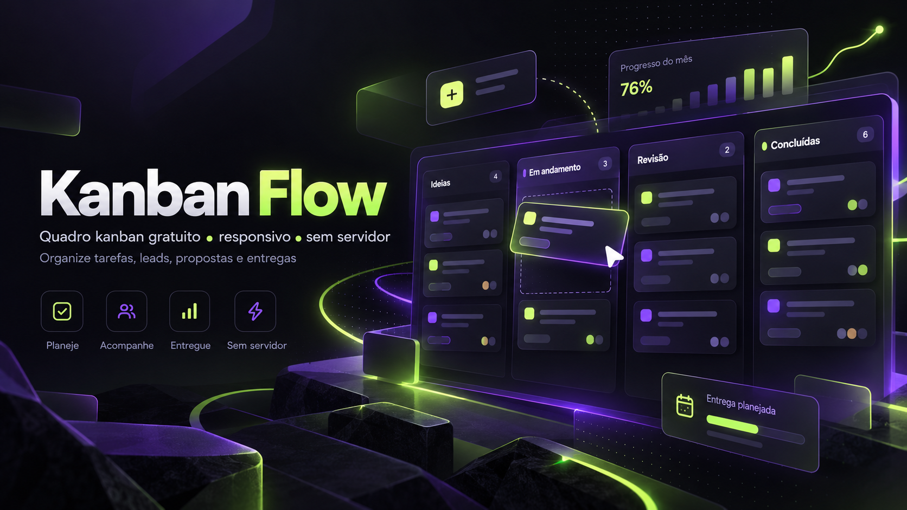

# Kanban Flow 🚀

**Organize tarefas, leads, propostas, produção, entregas e suporte em um quadro Kanban gratuito, responsivo e sem servidor.**

[🚀 Acessar o aplicativo](https://weslleyanjos03-png.github.io/IA-Teste/) · [⭐ Dar uma estrela](https://github.com/weslleyanjos03-png/IA-Teste) · [🐛 Relatar problema](https://github.com/weslleyanjos03-png/IA-Teste/issues)

### ✨ Funcionalidades

- Cinco etapas: Primeiro contato, Proposta, Em produção, Entrega e Suporte.
- Criar, editar, concluir, mover e excluir tarefas.
- Arrastar cartões no computador e alterar etapas no celular.
- Buscar tarefas e filtrar por categoria ou conclusão.
- Anexar links a tarefas e compartilhar mensagens via WhatsApp.
- Exportar e importar backups em JSON.
- Interface adaptada a celulares, tablets e computadores.

### ⚡ Como usar

Acesse a **[demonstração online](https://weslleyanjos03-png.github.io/IA-Teste/)** e comece a organizar suas tarefas. Para executar localmente, baixe o repositório e abra o arquivo **index.html** no navegador. Não é necessário criar conta, instalar dependências ou configurar backend.

### 🔒 Privacidade

O quadro começa vazio: nenhuma tarefa ou dado de cliente é publicado com o aplicativo. Seus dados ficam no armazenamento local do navegador usado e **não são sincronizados entre dispositivos**. O armazenamento e os arquivos JSON de backup não são criptografados; evite guardar informações altamente sensíveis e faça backups regularmente. Limpar os dados do navegador pode apagar tarefas.

### 🛠️ Tecnologias

**HTML5 · CSS3 · JavaScript · localStorage · GitHub Pages**

### 🤝 Comunidade

Encontrou um bug ou quer propor uma melhoria? [Abra uma issue](https://github.com/weslleyanjos03-png/IA-Teste/issues). Não envie senhas, backups ou dados reais de clientes em issues públicas.

Se o projeto ajudar na sua rotina, deixe uma ⭐ **Star** no GitHub e compartilhe com outras pessoas.

---

*Imagem de abertura: arte promocional conceitual. A interface real está disponível na demonstração online.*

**Projeto Weslley.IA — Kanban Flow**

*English: A free, responsive, no-backend Kanban board for tasks and customer pipelines. Try the [live demo](https://weslleyanjos03-png.github.io/IA-Teste/).*
Testes de sistema , SaaS+ IA
